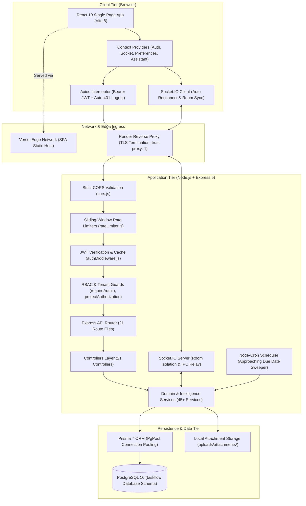
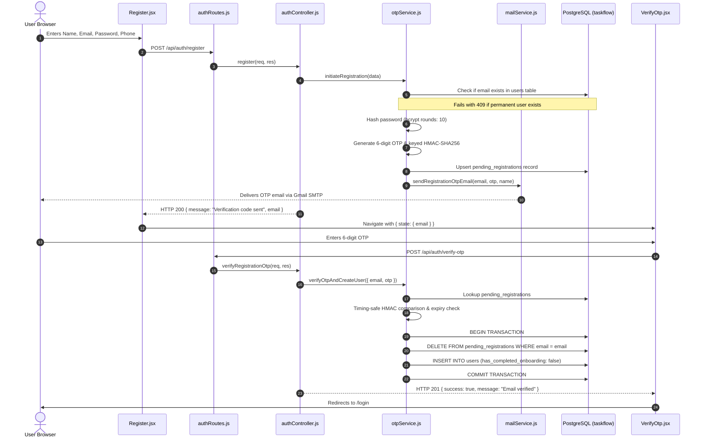
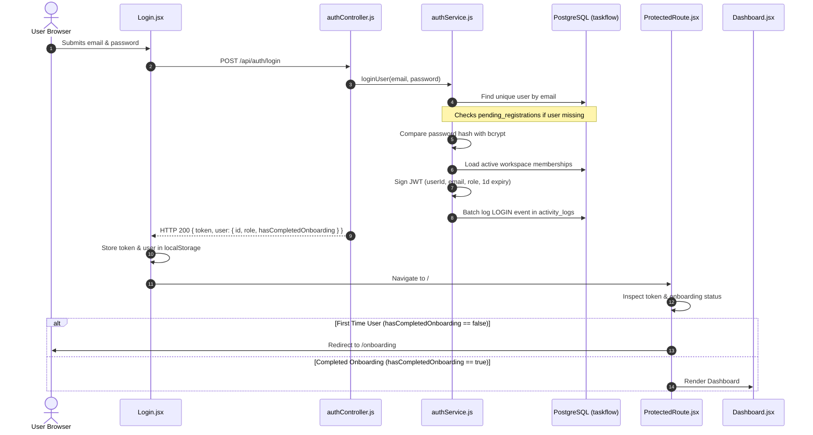
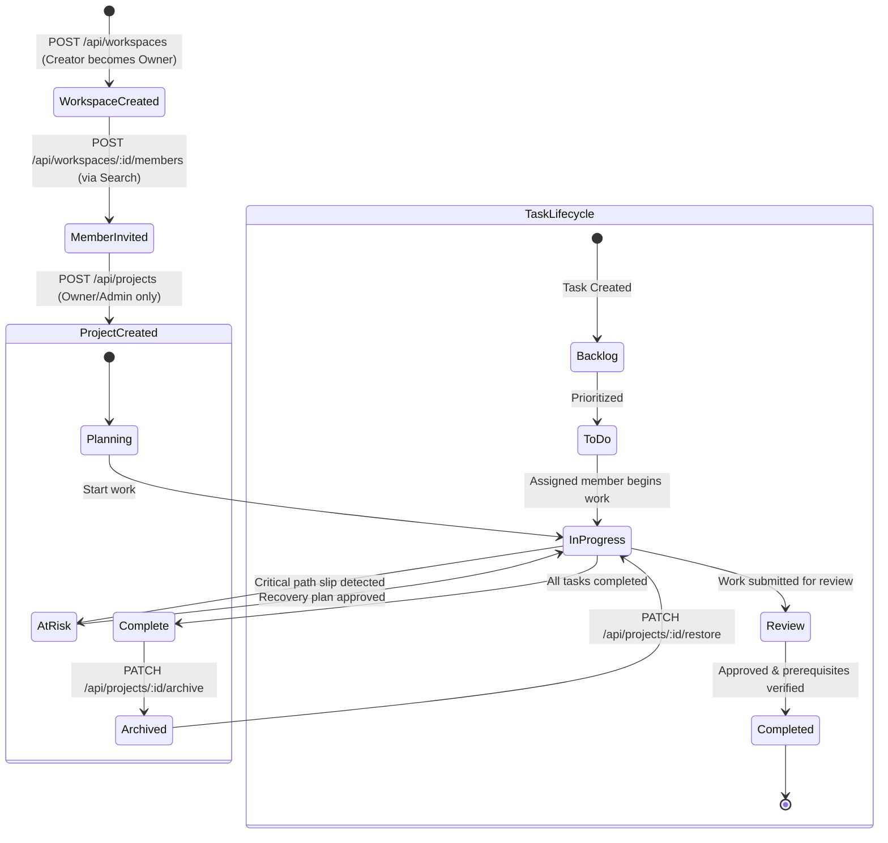
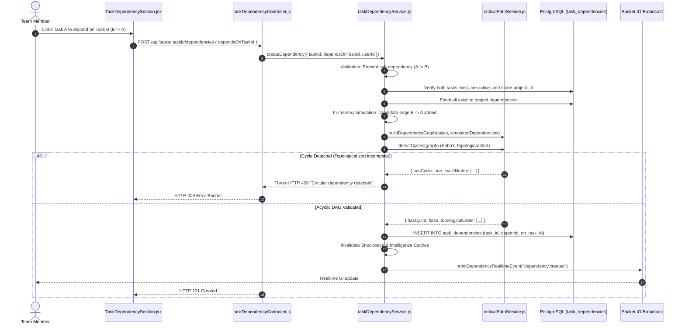
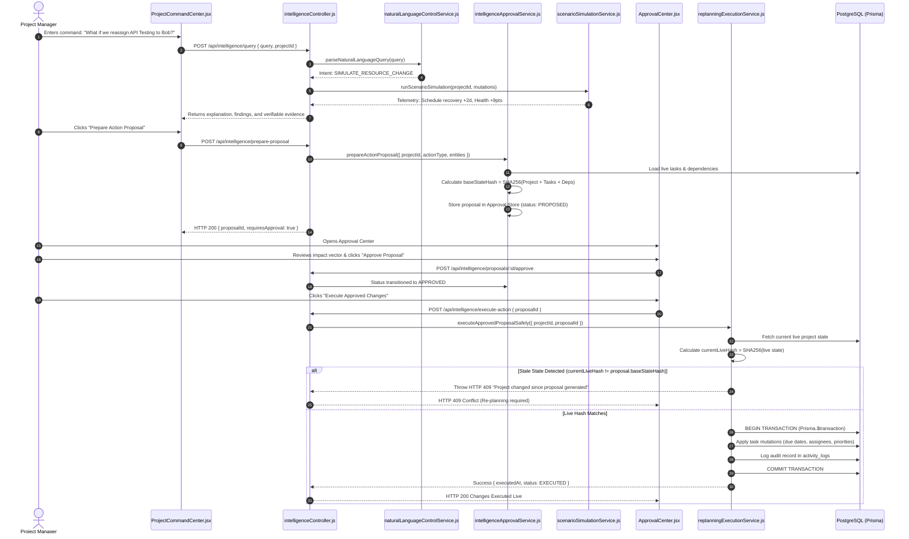
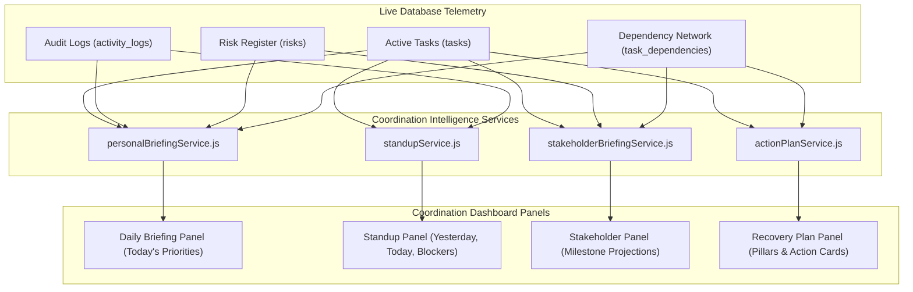
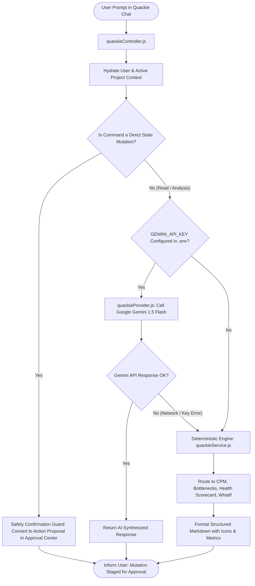
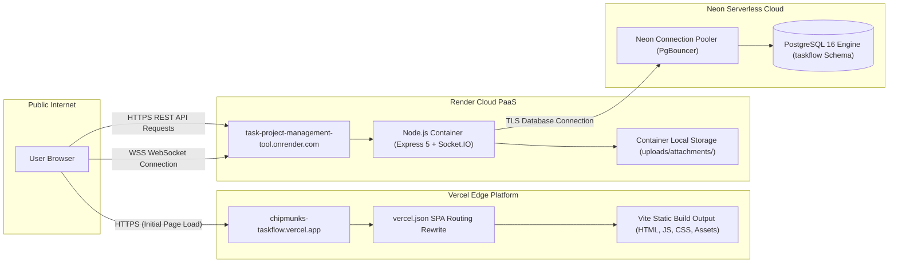

# TASKFLOW — COMPLETE TECHNICAL ARCHITECTURE SPECIFICATION

**System Architecture & Technical Reference Guide**  
**Repository:** `Task-Project-management-Tool`  
**Revision:** 2.4.0 (Production Verified)  
**Date:** November 11, 2026  

---

## 1. HIGH-LEVEL SYSTEM ARCHITECTURE

TaskFlow is architectured as a multi-tier, decoupled client-server web platform optimized for low latency, strict multi-tenant isolation, real-time collaboration, and deterministic algorithmic analysis.



---

## 2. FRONTEND ARCHITECTURE

The frontend is constructed using **React 19**, **Vite 8**, and **Tailwind CSS 4**:

### Directory Structure & Responsibilities
- `frontend/src/pages/`: Page-level components corresponding to application routes (`Dashboard.jsx`, `Projects.jsx`, `Tasks.jsx`, `Kanban.jsx`, `Calendar.jsx`, `Reports.jsx`, `Productivity.jsx`, `Chat.jsx`, `WhatIf.jsx`, `ProjectCommandCenterPage.jsx`, `CoordinationPage.jsx`, `AdminDashboardPage.jsx`).
- `frontend/src/components/`: Modular UI widgets divided by functional domain (`activity/`, `admin/`, `assistant/`, `auth/`, `brand/`, `coordination/`, `dashboard/`, `decisions/`, `files/`, `intelligence/`, `kanban/`, `notifications/`, `onboarding/`, `projects/`, `search/`, `settings/`, `tasks/`, `ui/`).
- `frontend/src/layouts/`: Layout shells (`MainLayout.jsx`, `AuthLayout.jsx`) providing uniform sidebar navigation, top bar controls, user profile menus, and Quackie floating assistant docks.
- `frontend/src/context/`: Global reactive state providers:
  - `SocketContext.jsx`: Manages the lifecycle of the Socket.IO connection, active room subscriptions, and reconnection event handling.
  - `AssistantContext.jsx`: Manages Quackie assistant drawer open/close states, active conversation histories, and page context hydration (`setPageContext`).
  - `PreferencesContext.jsx`: Manages user interface settings (theme switching, interface density, quiet hours).
- `frontend/src/services/api/`: Domain-specific API client wrappers around a preconfigured Axios instance (`axios.js`).

### Performance & Bundle Optimization
- **Code-Splitting via `React.lazy` & `Suspense`:** In `frontend/src/routes/AppRoutes.jsx`, all primary routes are dynamically loaded (`lazy(() => import(...))`). This reduces the initial bundle size, allowing the initial login page to load in under 200ms.
- **Client Routing Rewrites:** `vercel.json` contains a rewrite rule routing all path patterns (`/(.*)`) to `/index.html` to prevent 404 errors during client-side deep linking and page refreshes.

---

## 3. BACKEND ARCHITECTURE

The backend is built on **Express 5** and **Node.js**:

### Middleware Pipeline Execution Order
1. `app.set("trust proxy", 1)`: Enables secure IP resolution (`req.ip`) behind Render/Cloudflare proxies without trusting arbitrary client spoofing headers.
2. `cors(getCorsOptions())`: Dynamic origin validator inspecting `ALLOWED_ORIGINS` and `FRONTEND_URL`. Rejects unauthorized origins with HTTP 403 Forbidden.
3. `express.json()`: Parses incoming JSON payloads up to configured body limits.
4. Direct Static `/uploads` Blocker: Explicitly intercepts any direct request to `/uploads` and returns HTTP 403 Forbidden to protect multi-tenant file attachments.
5. In-Memory Sliding-Window Rate Limiters:
   - `loginRateLimiter`: 30 attempts per 15 minutes per IP.
   - `loginAccountRateLimiter`: 5 failed attempts per 15 minutes per email.
   - `registerRateLimiter`: 10 registration requests per hour per IP.
   - `forgotPasswordRateLimiter`: 5 reset requests per hour per IP.
6. Authentication Middleware (`authMiddleware.js`): Verifies JWT signatures, cross-references token IDs against the active user cache and in-memory revocation list, and populates `req.user`.
7. Authorization Guards:
   - `requireAdmin.js`: Rejects requests from non-Admin users on `/api/admin/*` routes with HTTP 403.
   - `canManageProject` / `verifyProjectAccess`: Live database queries checking `workspace_members` and `project_members` tables.
8. Centralized Error Handling Middleware: Catches PostgreSQL/Prisma error codes (`P2002` duplicate unique key $\rightarrow$ 409 Conflict, `23514` check constraint violation $\rightarrow$ 400 Bad Request, `P2025` record not found $\rightarrow$ 404 Not Found) without exposing raw SQL or stack traces.

---

## 4. MERMAID ARCHITECTURAL WORKFLOWS

### Diagram 1: Registration and Email OTP Verification Flow


---

### Diagram 2: Login and Authorization Lifecycle


---

### Diagram 3: Workspace, Project, and Task Lifecycle


---

### Diagram 4: Task Dependency & Cycle Detection Workflow


---

### Diagram 5: Command Center Request & Stale-State Protected Execution Flow


---

### Diagram 6: Coordination Intelligence Workflow


---

### Diagram 7: Quackie Assistant Request Workflow


---

## 5. DATABASE ARCHITECTURE & CONSTRAINTS

TaskFlow operates in PostgreSQL 16 within the dedicated `taskflow` schema.
- **ACID Guarantee:** Multi-record operations (such as registration OTP verification and action plan execution) run within `prisma.$transaction()` blocks.
- **Constraints Enforced at DB Level:**
  - `uq_pending_registrations_email`: Unique index on pending registrations.
  - `uq_workspace_member`: Composite unique constraint on `(workspace_id, user_id)`.
  - `uq_project_member`: Composite unique constraint on `(project_id, user_id)`.
  - `pk_task_dependencies`: Composite primary key on `(task_id, depends_on_task_id)`.
  - `uq_workspace_label`: Composite unique constraint on `(workspace_id, name)`.
  - `chk_project_dates`: `start_date <= end_date`.
  - `chk_task_dates`: `start_date <= due_date`.

---

## 6. FILE STORAGE ARCHITECTURE

```
Client Browser (Upload)
      │
      ▼
POST /api/attachments (Multipart Form-Data)
      │
      ├─► Multer Storage Middleware (uploadMiddleware.js)
      │     ├─ Validates MIME type against ALLOWED_MIME_TYPES
      │     ├─ Rejects dangerous file extensions (.exe, .sh, .bat, .php)
      │     └─ Generates UUID filename: <uuid>.<ext>
      │
      ├─► Persisted to local disk: uploads/attachments/<filename>
      │
      └─► Metadata record inserted into PostgreSQL: taskflow.attachments
            (file_name, file_url, file_type, file_size, uploaded_by, project_id, task_id)

Client Browser (Download)
      │
      ▼
GET /api/attachments/:id/download (Authorized Stream)
      │
      ├─► Attachment Controller (attachmentController.js)
      │     ├─ Verifies user JWT authentication
      │     ├─ Checks user workspace & project membership (Tenant Isolation)
      │     └─ Resolves physical disk path: uploads/attachments/<filename>
      │
      └─► Streams file to client with Content-Disposition attachment header
```

---

## 7. REAL-TIME COLLABORATION ARCHITECTURE

Real-time collaboration is powered by **Socket.IO**:
- **Room Isolation:** Clients join specific project and workspace rooms upon opening a view (`socket.emit("join_project", projectId)`).
- **Event Bus:** Domain events are dispatched server-side using `emitRealtimeEvent(payload)` from `backend/src/socket.js`.
- **Clustering Support:** In cluster mode (`CLUSTER_MODE=true`), the primary Node.js process acts as an IPC message relay (`worker.on("message", relayIpcMessage)`), broadcasting socket events across all cluster worker processes.
- **Client Reactive Handling:** Frontend components use the custom hook `useSocketEvent(eventType, callback)` to listen for changes and update local React state optimistically or re-fetch telemetry.

---

## 8. DEPLOYMENT ARCHITECTURE


